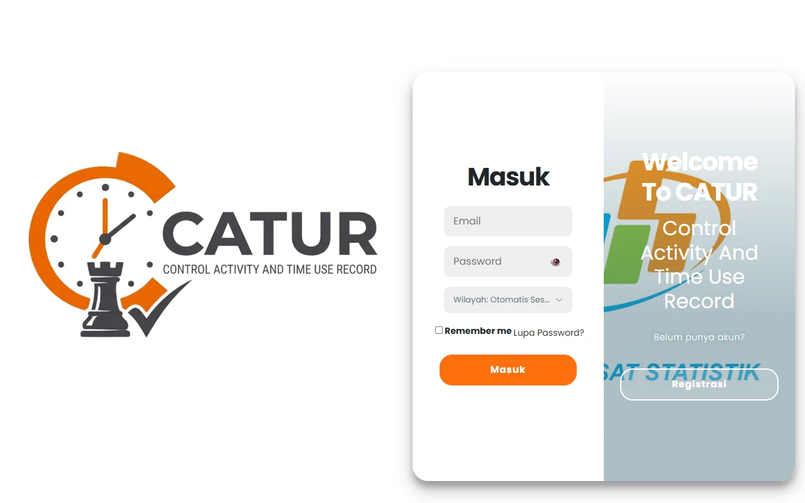

# CATUR Web BPS
> **Control of Activity and Time Use Record** — Platform terpadu surat tugas perjalanan dinas, presensi GPS/swafoto, pelaporan, persetujuan berjenjang, dan pencairan dana.

🔗 **Live Portal:** [`https://caturv2.gimmhost.my.id/`](https://caturv2.gimmhost.my.id/) &nbsp;|&nbsp; **Stack:** React · Vite · Express · Sequelize · PostgreSQL · Flutter



### Alur & Aturan Bisnis (`Asia/Makassar` WITA)

| Tahap | Peran | Aturan Sistem |
| :--- | :--- | :--- |
| **1. Surat Tugas & Presensi** | Pegawai / Lapangan | Check-in GPS & foto via Web atau companion app Flutter |
| **2. Laporan Perjalanan** | Pegawai | 1 laporan per pasangan surat–pegawai (`draft` → `kirim` + TTD + nota) |
| **3. Deadline 7 Hari** | Enforcement Backend | Terbuka s/d 23:59:59 WITA H+7; terkunci via HTTP `409 REPORT_DEADLINE_PASSED` |
| **4. Verifikasi Keuangan** | Supervisor / Finance | Mengunci suntingan saat status masuk `dicek_keuangan` → `dana_turun` |

### Quick Start

```powershell
# Backend (PostgreSQL 17 required)
cd backend && npm install && node server.js

# Frontend
cd frontend && npm install && npm run dev
```

<details>
<summary><b>Migration, Testing &amp; Linting Commands</b></summary>

```powershell
psql -d catur_dev -f backend/migrations/20260914-enforce-report-integrity.sql
cd backend && npm test && npm run lint
cd frontend && npm test
```

</details>
