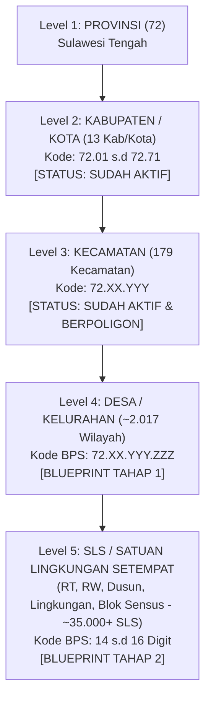
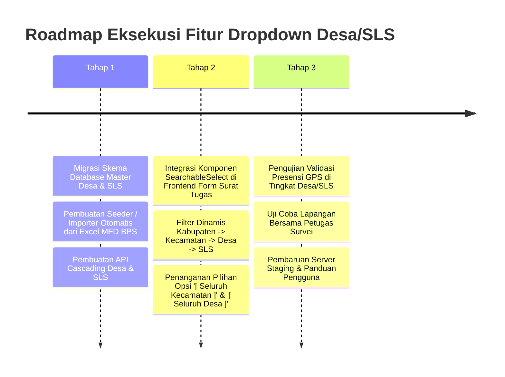

# BLUEPRINT & ARSITEKTUR FITUR DROPDOWN CASCADING: KABUPATEN → KECAMATAN → DESA → SLS
**Aplikasi:** CATUR (*Control Activity and Time Use Record*) — BPS Provinsi Sulawesi Tengah  
**Klasifikasi Dokumen:** Rencana Strategis & Blueprint Arsitektur Sistem  
**Target Pembahasan:** Bahan Diskusi Teknis & Pengambilan Keputusan bersama Pimpinan / Atasan  
**Tanggal Penyusunan:** 06 November 2026  
**Status Fitur:** 
* **Level 1 (Provinsi) & Level 2 (Kabupaten/Kota):** Selesai & Terpasang *(13 Satker Kab/Kota)*
* **Level 3 (Kecamatan):** Selesai & Terpasang *(179 Kecamatan dengan Poligon Lengkap)*
* **Level 4 (Desa/Kelurahan) & Level 5 (SLS):** **Siap Dijalankan Sesuai Blueprint Ini**

---

## 1. RINGKASAN EKSEKUTIF (EXECUTIVE OVERVIEW)

Pada pembaruan sebelumnya (**TASK-045**), aplikasi CATUR telah berhasil menerapkan:
1. **Pembatasan Akses Login Satker Kabupaten/Kota:** Akun pegawai dari satker BPS Kabupaten/Kota (contoh: BPS Sigi, BPS Morowali, dll) secara otomatis terkunci hanya dapat memilih wilayah penugasan di wilayah hukum kabupatennya. Sedangkan akun BPS Provinsi memiliki akses penuh ke seluruh 13 kabupaten/kota.
2. **Cascading Dropdown Tingkat Kecamatan:** Dropdown wilayah penugasan pada pembuatan Surat Tugas telah memetakan seluruh **179 Kecamatan se-Sulawesi Tengah** yang telah dilengkapi data batas wilayah poligon spasial (*GeoJSON*).

Sesuai arahan sebelumnya, **fitur pemilihan Desa/Kelurahan dan SLS (Satuan Lingkungan Setempat seperti Dusun, RT, RW, Lingkungan, atau Blok Sensus)** disiapkan dokumen rencana dan arsitekturnya secara matang terlebih dahulu agar siap dieksekusi saat atasan memberikan persetujuan.

Dokumen ini memaparkan:
* Alasan mengapa penambahan Desa dan SLS memerlukan penanganan arsitektur khusus.
* Solusi cerdas agar aplikasi di HP pegawai tetap ringan dan tidak macet.
* Pilihan mode validasi presensi (Radius vs Poligon).
* Alur antarmuka pengguna (*UI/UX Flow*).
* Kebutuhan data master dari BPS yang perlu disiapkan.

---

## 2. HIERARKI KODIFIKASI WILAYAH BPS

Kodifikasi wilayah BPS memiliki struktur baku bertingkat (*hierarchical coding*):



* **Level 1–3 (Provinsi s.d Kecamatan):** Sudah berjalan 100% di sistem CATUR dengan 179 poligon kecamatan.
* **Level 4 (Desa/Kelurahan):** Mencakup **2.017 Desa dan Kelurahan** se-Sulawesi Tengah (berdasarkan Master File Desa / MFD BPS terbaru).
* **Level 5 (SLS):** Mencakup puluhan ribu unit lingkungan terkecil (RT, RW, Dusun, Banjar, Lingkungan) yang biasa digunakan petugas sensus/survei (SP2020, ST2023, Regsosek, Susenas, Sakernas).

---

## 3. TANTANGAN TEKNIS & SOLUSI ARSITEKTUR CERDAS

### ⚠️ Tantangan Utama (Masalah Volume Data Spasial):
* Jika seluruh 2.017 desa dan puluhan ribu poligon SLS dimasukkan sekaligus ke dalam aplikasi atau browser:
  1. Ukuran file peta bisa membengkak hingga **ratusan Megabyte (MB)**.
  2. HP pegawai di lapangan akan mengalami **lag parah, kehabisan memori (RAM), hingga aplikasi keluar sendiri (*force close*)**.
  3. Kuota internet pegawai akan terkuras hanya untuk mengunduh daftar wilayah saat membuka form surat tugas.

### 💡 Solusi Arsitektur: *Hierarchical Lazy Loading & On-Demand Fetching*
Sistem akan memisahkan data menjadi **dua lapisan yang efisien**:

1. **Lapisan 1: Master Data Tabular (Nama & Kode Wilayah) — Sangat Ringan:**
   * Data nama Kabupaten, Kecamatan, Desa, dan SLS disimpan dalam tabel database yang terindeks cepat.
   * **Cascading Otomatis di Frontend:**
     * Ketika Admin memilih **Kecamatan Palu Selatan**, frontend hanya meminta daftar desa di Palu Selatan ke server via API:
       `GET /api/wilayah/desa?kdkec=7271020`
     * Ukuran data yang dikirim hanya sekitar **2 hingga 5 KB** (sangat instan, < 0.1 detik).
     * Ketika Admin memilih **Desa Tatura Selatan**, barulah frontend meminta daftar SLS di desa tersebut:
       `GET /api/wilayah/sls?kddesa=7271020009`

2. **Lapisan 2: Validasi Titik Presensi GPS di Lapangan (Dua Pilihan Mode untuk Atasan):**

| Mode Validasi | Cara Kerja di Lapangan | Kebutuhan Data dari BPS | Kelebihan bagi Petugas BPS |
| :--- | :--- | :--- | :--- |
| **MODE A (Rekomendasi Utama):**<br>**Hybrid Poligon & Centroid-Radius** | • Level Kab & Kec: Pakai Poligon batas wilayah resmi (sudah ada).<br>• Level Desa & SLS: Menggunakan titik koordinat pusat (*centroid / latitude-longitude*) + radius toleransi (contoh: 1.000m untuk desa, 300m untuk SLS). | Cukup file Excel/CSV Master File Desa & SLS yang memiliki kolom Latitude & Longitude kantor desa / titik SLS. | • Sangat ringan dan cepat.<br>• Kuota internet irit.<br>• Tidak membutuhkan file shapefile poligon SLS yang berat.<br>• Sangat toleran terhadap GPS HP yang meleset sedikit di pelosok. |
| **MODE B:**<br>**Full Poligon Spasial (Server-Side Turf.js)** | Setiap batas fisik RT/Dusun/Desa digambar sebagai poligon geometri lengkap. Saat absen, server mencocokkan apakah GPS petugas berada di dalam poligon (*Point-in-Polygon*). | Membutuhkan file GeoJSON/Shapefile poligon lengkap seluruh 2.017 desa dan ~35.000 SLS dari tim IPDS/Pengolahan BPS. | • Batas wilayah sangat presisi sesuai batas peta sensus.<br>*(Catatan: Membutuhkan data shapefile SLS yang sangat besar dan lengkap dari BPS Provinsi)*. |

> [!TIP] **Saran Rekomendasi Tim Teknis:**  
> Untuk tahap awal, gunakan **MODE A (Hybrid Poligon Kecamatan + Centroid Radius Desa/SLS)**. Mode ini dapat langsung diterapkan segera setelah BPS menyediakan master daftar desa dan SLS, tanpa menunggu ketersediaan peta poligon detail yang ukurannya raksasa.

---

## 4. DESAIN ANTARMUKA PENGGUNA (UI/UX FLOW)

Pada form pembuatan Surat Tugas (`suratTugasCreate.jsx` / `TujuanScheduleEditor.jsx`), antarmuka jadwal tujuan disempurnakan dengan konsep **"Tingkat Ketelitian Fleksibel (*Flexible Granularity*)"**:

### Alur Pemilihan Wilayah:
```
1. [ Kabupaten / Kota ] ────────► Pilihan 13 Kab/Kota (Otomatis terkunci untuk satker BPS daerah)
        │
        ▼ (Otomatis memfilter)
2. [ Kecamatan ]        ────────► Pilihan Kecamatan yang ada di Kabupaten tersebut (Berpoligon)
        │
        ▼ (Otomatis memfilter)
3. [ Desa / Kelurahan ] ────────► Pilihan Desa di Kecamatan terkait + Pilihan "[ Seluruh Kecamatan ]"
        │
        ▼ (Opsional)
4. [ SLS / Dusun / RT ] ────────► Pilihan SLS di Desa terkait + Pilihan "[ Seluruh Desa ]"
```

### Fleksibilitas Bagi Pembuat Surat Tugas:
* **Skenario 1 (Supervisi Umum Pimpinan / Atasan):**  
  Atasan melakukan supervisi umum se-Kecamatan Luwuk. Atasan cukup memilih sampai level **Kecamatan Luwuk**. Kolom Desa dan SLS otomatis diisi *"[ Seluruh Wilayah Kecamatan ]"*. Validasi presensi menggunakan poligon batas kecamatan Luwuk.
* **Skenario 2 (Petugas Survei Spesifik / Lapangan):**  
  Petugas melakukan pendataan survei sosial ekonomi di **Desa Tatura Selatan - RT 02 RW 03**. Admin memilih Kabupaten Palu $\rightarrow$ Kecamatan Palu Selatan $\rightarrow$ Desa Tatura Selatan $\rightarrow$ SLS "RT 02 RW 03". Validasi presensi memastikan petugas benar-benar berada di RT tersebut.

---

## 5. SKEMA BASIS DATA & ARSITEKTUR BACKEND

Untuk mengimplementasikan fitur ini secara bersih tanpa mengganggu database produksi yang sedang berjalan:

### 1. Tabel Baru: `master_desa`
```sql
CREATE TABLE master_desa (
    id SERIAL PRIMARY KEY,
    id_desa VARCHAR(10) UNIQUE NOT NULL,      -- Contoh: '7271020009'
    id_kec VARCHAR(7) NOT NULL,               -- Contoh: '7271020'
    kdkab VARCHAR(2) NOT NULL,                -- '71'
    kdkec VARCHAR(3) NOT NULL,                -- '020'
    kddesa VARCHAR(3) NOT NULL,               -- '009'
    nama_desa VARCHAR(100) NOT NULL,          -- 'TATURA SELATAN'
    tipe VARCHAR(20) DEFAULT 'DESA',          -- 'DESA' atau 'KELURAHAN'
    latitude DOUBLE PRECISION,
    longitude DOUBLE PRECISION,
    radius_meter INTEGER DEFAULT 1500,        -- Toleransi radius default
    created_at TIMESTAMP DEFAULT CURRENT_TIMESTAMP
);
CREATE INDEX idx_master_desa_kec ON master_desa(id_kec);
```

### 2. Tabel Baru: `master_sls`
```sql
CREATE TABLE master_sls (
    id SERIAL PRIMARY KEY,
    id_sls VARCHAR(16) UNIQUE NOT NULL,       -- Contoh: '72710200090011'
    id_desa VARCHAR(10) NOT NULL,             -- '7271020009'
    kdsls VARCHAR(4) NOT NULL,                -- '0011'
    nama_sls VARCHAR(150) NOT NULL,           -- 'RT 02 RW 03'
    latitude DOUBLE PRECISION,
    longitude DOUBLE PRECISION,
    radius_meter INTEGER DEFAULT 500,         -- Toleransi radius RT/Dusun
    created_at TIMESTAMP DEFAULT CURRENT_TIMESTAMP
);
CREATE INDEX idx_master_sls_desa ON master_sls(id_desa);
```

### 3. Pembaruan Tabel `surat_tugas_tujuan`
Menambahkan kolom referensi tingkat detail penugasan:
* `desa_id` (FK nullable ke `master_desa`)
* `sls_id` (FK nullable ke `master_sls`)
* `level_tujuan` (`'KECAMATAN'`, `'DESA'`, `'SLS'`)

### 4. API Endpoints:
* `GET /api/wilayah/kabupaten` $\rightarrow$ Daftar 13 Kab/Kota (Cached)
* `GET /api/wilayah/kecamatan?kdkab=...` $\rightarrow$ Daftar Kecamatan dalam Kab/Kota
* `GET /api/wilayah/desa?idkec=...` $\rightarrow$ Daftar Desa/Kelurahan dalam Kecamatan
* `GET /api/wilayah/sls?iddesa=...&search=...` $\rightarrow$ Daftar SLS dalam Desa (dilengkapi fitur pencarian cepat)

---

## 6. CHECKLIST DATA YANG PERLU DISIAPKAN BPS (UNTUK DIDISKUSIKAN DENGAN ATASAN)

Agar fitur Desa dan SLS dapat diaktifkan, berikut adalah berkas yang perlu dimintakan ke **Tim Pengolahan / IPDS BPS Provinsi Sulawesi Tengah**:

1. **Master File Desa (MFD) Terkini:**
   * File Excel/CSV berisi daftar seluruh Desa dan Kelurahan di Sulawesi Tengah dengan kolom:
     * `Kode BPS Provinsi` (72)
     * `Kode & Nama Kabupaten/Kota`
     * `Kode & Nama Kecamatan`
     * `Kode & Nama Desa/Kelurahan`
     * *(Opsional/Sangat Baik jika ada)*: Titik Koordinat Kantor Desa/Kelurahan (*Latitude, Longitude*).
2. **Master SLS (Satuan Lingkungan Setempat):**
   * File Excel/CSV Master SLS (misalnya hasil pemutakhiran kerangka geospasial SP2020 / ST2023 / Regsosek) yang berisi:
     * `Kode & Nama Desa`
     * `Kode & Nama SLS` (contoh: RT 01, Dusun Karawana, Lingkungan I, dll).
     * Titik koordinat centroid SLS *(jika tersedia)*.
3. **Keputusan Mode Validasi:**
   * Konfirmasi dari pimpinan apakah penugasan level Desa/SLS cukup menggunakan koordinat titik pusat (*Centroid + Radius*) atau harus menunggu kelengkapan peta poligon spasial.

---

## 7. ROADMAP PELAKSANAAN KETIKA DISETUJUI ATASAN

Ketika pimpinan telah memberikan arahan dan data master telah tersedia, pengerjaan dapat dilakukan secara bertahap dalam **3 sprint kerja terukur**:



---

*Blueprint ini telah disusun secara lengkap dan siap menjadi bahan presentasi atau lampiran teknis saat berdiskusi dengan pimpinan BPS Provinsi Sulawesi Tengah.*
