# LAPORAN REKAPITULASI PENGEMBANGAN SISTEM, PERBAIKAN BUG, DAN STATUS FITUR CATUR
**Aplikasi:** CATUR (*Control Activity and Time Use Record*) — BPS Provinsi Sulawesi Tengah  
**Klasifikasi:** Laporan Kemajuan Proyek & Akuntabilitas Teknis  
**Tanggal Pelaporan:** 06 November 2026  
**Lingkungan Deploy:** `https://caturv2.gimmhost.my.id/` (Staging Server BPS)  
**Status Pengujian:** 100% Lulus (12/12 Unit Test Terverifikasi & Lolos Build Production)

---

## 1. RINGKASAN EKSEKUTIF (APA SAJA YANG TELAH KITA LAKUKAN)

Sepanjang rangkaian sesi kerja ini, tim pengembang telah melakukan serangkaian pembaruan, pengujian, audit, dan perbaikan menyeluruh pada aplikasi **CATUR**. Fokus utama mencakup:
1. **Desain Ulang Antarmuka (UI/UX):** Mengganti dropdown standar dengan komponen combobox pencarian berformat Daftar Isi (*table of contents layout* dengan *dotted leader* ke badge tipe wilayah di paling kanan).
2. **Perbaikan Tata Letak Responsif:** Memperbaiki sistem sidebar dan navbar agar tidak saling bertabrakan (*sidebar collision*) di layar tablet dan smartphone menggunakan sistem laci *off-canvas*.
3. **Penyelesaian 2 Bug Kritis di Lapangan:**
   * Bug penyimpanan laporan harian pada halaman Tagging Perjadin yang sebelumnya terbaca kosong.
   * Bug hilangnya seluruh opsi dropdown wilayah tujuan saat filter wilayah dikosongkan/dinonaktifkan.
4. **Implementasi Fitur Akses Satker Kabupaten/Kota:** Mengunci akses wilayah secara otomatis sesuai unit kerja akun BPS daerah (contoh: akun BPS Kabupaten Donggala hanya dapat memilih kecamatan di Donggala), serta cascading dropdown Kabupaten $\rightarrow$ Kecamatan ber-poligon (13 Kab/Kota & 179 Kecamatan se-Sulteng).
5. **Audit Sistem Menyeluruh:** Mengidentifikasi 9 celah keamanan dan logika alur presensi multi-tujuan, menyusun Implementation Plan perbaikan, dan merapikan dokumen Word resmi non-teknis untuk pimpinan.
6. **Penyusunan Blueprint Fitur Desa/SLS:** Menyusun rencana arsitektur *hierarchical lazy loading* agar penambahan 2.017 desa dan puluhan ribu SLS tidak membuat HP pegawai lemot atau kehabisan memori.

---

## 2. RINCIAN BUG YANG BERHASIL DISELESAIKAN (SOLVED)

### A. Bug Simpan Laporan Harian Terbaca Kosong pada Tagging Perjadin (TASK-044)
* **Gejala:**  
  Saat pegawai selesai melakukan swafoto presensi (Step 1) dan mengisi formulir laporan harian (Step 2) di halaman Tagging Perjadin (`PresensiPegawai.jsx`), ketika tombol *Simpan Laporan* ditekan, sistem menolak dengan pesan error *"Laporan tidak boleh kosong"*, dan laporan tidak tersimpan.
* **Akar Masalah (*Root Cause*):**  
  Terjadi ketidakcocokan tanda tangan fungsi (*signature mismatch*). Komponen `PresensiPegawai.jsx` mengirimkan 1 argumen berupa objek `{ laporan, presensi_id, surat_tugas_id }`, sedangkan fungsi `submitLaporan` di `presensiService.js` mengharapkan 2 argumen terpisah `(presensiId, laporan)`. Akibatnya, request HTTP terkirim ke URL `/presensi/[object Object]/laporan` dengan payload `{ laporan: undefined }`.
* **Solusi Perbaikan:**  
  * Memperbarui `frontend/src/services/presensiService.js` agar fleksibel menerima argumen ganda `(presensiId, laporan)` maupun objek `{ laporan, presensi_id }`.
  * Memperbarui `frontend/src/pages/pegawai/PresensiPegawai.jsx` agar langsung menyinkronkan status ke Step 3 (Selesai).
  * Memperkuat `backend/src/controllers/presensi.controller.js` dengan mekanisme pencarian otomatis presensi hari ini jika ID tidak dikirimkan.
* **Status:** **SOLVED, COMMITTED (`50232e1`), & DEPLOYED**.

---

### B. Bug Opsi Dropdown Wilayah Kosong Saat Filter Wilayah Tidak Aktif (TASK-047)
* **Gejala:**  
  Ketika tombol silang `(X)` pada dropdown *"Filter wilayah"* ditekan (sehingga teks filter kembali ke placeholder *"Semua Wilayah"*), dropdown *"Wilayah tujuan (Kecamatan)"* di bawahnya kehilangan seluruh opsi pilihannya (kosong melompong).
* **Akar Masalah (*Root Cause*):**  
  Ketika filter dibersihkan, nilai `daerahFilter` berubah menjadi string kosong `''`. Di dalam `TujuanScheduleEditor.jsx`, kode sebelumnya hanya mengecek `if (daerahFilter === 'all') return baseList;`. Karena string `''` tidak sama dengan `'all'`, sistem mencoba mencari daerah yang nilai kolom `titik_lokasi`-nya kosong string `''`. Karena semua data daerah di database memiliki tipe `'kecamatan'` atau `'kabupaten'`, hasil filter menjadi 0 data (`[]`).
* **Solusi Perbaikan:**  
  * Mengubah inisialisasi state menjadi `daerahFilter = ''` secara default.
  * Memperbaiki logika penyaringan pada `TujuanScheduleEditor.jsx` menjadi:
    ```javascript
    if (!daerahFilter || daerahFilter === 'all') return baseList;
    ```
  * Menambahkan unit test regresi di `TujuanScheduleEditor.test.jsx`.
* **Status:** **SOLVED, COMMITTED (`8e9154a`), & DEPLOYED**.

---

## 3. RINCIAN FITUR YANG BERHASIL DITAMBAHKAN

| No | Nama Fitur | Kode Task | Deskripsi & Manfaat Operasional | Status |
| :---: | :--- | :---: | :--- | :---: |
| **1** | **Dropdown Combobox Format Daftar Isi** | `TASK-042` | Dropdown kustom `SearchableSelect` dengan kotak pencarian instan (*live search*), navigasi keyboard penuh (*arrows, enter, esc*), dan tata letak ala Daftar Isi (*dotted leader* menghubungkan nama wilayah di kiri ke badge tipe di kanan). | **AKTIF & LIVE** |
| **2** | **Tata Letak Responsif Anti-Tabrakan** | `TASK-043` | Sidebar responsif dengan laci *off-canvas* dan *backdrop overlay* pada smartphone/tablet. Mencegah sidebar menabrak atau menutupi form input. | **AKTIF & LIVE** |
| **3** | **Pembatasan Hak Akses Satker Kab/Kota** | `TASK-045` | Penguncian wilayah akses yang melekat pada akun user (`wilayah_akses`). Akun BPS Kabupaten/Kota terkunci hanya pada wilayah hukumnya; akun Provinsi dapat mengakses seluruh wilayah. | **AKTIF & LIVE** |
| **4** | **Cascading Dropdown Kabupaten → Kecamatan** | `TASK-045` | Pemilihan wilayah berjenjang pada form Surat Tugas: memilih Kabupaten/Kota langsung menyaring hanya Kecamatan ber-poligon di kabupaten tersebut (mencakup 13 Kab/Kota & 179 Kecamatan se-Sulteng). | **AKTIF & LIVE** |

---

## 4. FITUR YANG BELUM DITAMBAHKAN & ALASANNYA

### 1. Dropdown Tingkat Desa/Kelurahan dan SLS (RT/RW/Dusun)
* **Status:** **Ditangguhkan Sementara (Blueprint & Rencana Siap 100%)**
* **Alasan Manajerial:** Sesuai arahan sebelumnya, penambahan level Desa dan SLS disepakati untuk ditunda terlebih dahulu guna didiskusikan dengan atasan.
* **Alasan Teknis:** Jumlah desa di Sulawesi Tengah mencapai **2.017 desa** dan SLS mencapai **lebih dari 35.000 titik**. Jika data ini dimasukkan sekaligus ke browser HP pegawai tanpa strategi khusus, aplikasi akan mengalami *lag* parah, memakan kuota besar, dan memori HP akan cepat habis.
* **Langkah Persiapan yang Sudah Selesai:** Telah disusun dokumen arsitektur komprehensif [BLUEPRINT_FITUR_DROPDOWN_DESA_DAN_SLS.docx](file:///c:/Users/Lyvn/Laravel/CATUR/BLUEPRINT_FITUR_DROPDOWN_DESA_DAN_SLS.docx) dengan strategi *Hierarchical Lazy Loading* dan Mode Hybrid Poligon/Radius.

---

### 2. Eksekusi Perbaikan 9 Temuan Audit Keamanan & Presensi Multi-Tujuan (TASK-046)
* **Status:** **Disimpan di Plan (Menunggu Persetujuan Atasan)**
* **Alasan Manajerial:** Sesuai instruksi: *"Save dulu temuan dan implementation plan soal bug kita ini, akan dieksekusi nanti setelah ditampilkan dan dijelaskan ke atasan"*.
* **Cakupan yang Siap Dieksekusi:**
  1. Penguncian registrasi akun publik agar tidak bisa memilih peran 'Admin' (`SEC-01`).
  2. Proteksi otorisasi admin pada API data wilayah & sinkronisasi peta (`SEC-02`).
  3. Perbaikan presensi multi-tujuan agar tidak terkunci pada lokasi pertama (`LOG-01`).
  4. Penghapusan kunci permanen jika pegawai terlewat absen 1 hari akibat mati lampu/sinyal (`LOG-02`).
  5. Penguncian tombol pencairan dana sebelum laporan ditandatangani atasan (`LOG-03`).
  6. Pembatasan upload berkas bukti keuangan hanya format PDF dan Foto (`SEC-04`).
  7. Proteksi privasi surat tugas antar-pegawai (`SEC-03`).
* **Langkah Persiapan yang Sudah Selesai:** Seluruh temuan telah dirangkum dalam bahasa non-teknis yang dilengkapi simulasi lapangan pada dokumen [audit_comprehensive_report.docx](file:///c:/Users/Lyvn/Laravel/CATUR/audit_comprehensive_report.docx) dan siap dieksekusi segera setelah atasan memberikan persetujuan.

---

## 5. MATRIKS PERUBAHAN FILE & ARSITEKTUR KODE

```mermaid
flowchart LR
    subgraph Frontend ["Frontend (React + Vite)"]
        SS["SearchableSelect.jsx\n(Combobox & Dotted Leader)"]
        TSE["TujuanScheduleEditor.jsx\n(Cascading Kab -> Kec)"]
        WHF["wilayahHierarki.js\n(13 Kab & 179 Kec Sulteng)"]
        PP["PresensiPegawai.jsx\n(Fix Simpan Laporan)"]
        SB["Sidebar & Navbar Context\n(Responsive Off-Canvas)"]
    end

    subgraph Backend ["Backend (Node.js Express + Sequelize)"]
        WHB["wilayahHierarki.js\n(Access Resolver)"]
        DC["daerah.controller.js\n(Metadata Level Wilayah)"]
        PC["presensi.controller.js\n(Fix Payload Laporan)"]
    end

    subgraph Server ["Staging Server (Passenger cPanel)"]
        DEP["https://caturv2.gimmhost.my.id/\n(Bundle index-bJ9vKyxo.js Aktif)"]
    end

    Frontend --> Backend --> Server
```



* **Frontend Codebase:**
  * `frontend/src/features/surat-tugas/SearchableSelect.jsx` & `.css` *(Baru)*
  * `frontend/src/features/surat-tugas/SearchableSelect.test.jsx` *(Baru - 10 Test)*
  * `frontend/src/features/surat-tugas/wilayahHierarki.js` *(Baru)*
  * `frontend/src/features/surat-tugas/TujuanScheduleEditor.jsx` *(Diperbarui)*
  * `frontend/src/features/surat-tugas/TujuanScheduleEditor.test.jsx` *(Diperbarui - 12 Test)*
  * `frontend/src/pages/pegawai/PresensiPegawai.jsx` & `presensiService.js` *(Diperbarui)*
  * `frontend/src/contexts/SidebarContext.jsx` & Layout Wrappers *(Diperbarui)*
* **Backend Codebase:**
  * `backend/src/utils/wilayahHierarki.js` *(Baru)*
  * `backend/tests/unit/wilayahHierarki.test.js` *(Baru - 3 Test)*
  * `backend/src/controllers/daerah.controller.js`, `auth.controller.js`, `akun.controller.js` *(Diperbarui)*
  * `backend/src/controllers/presensi.controller.js` *(Diperbarui)*

---

## 6. KESIMPULAN & REKOMENDASI TINDAK LANJUT

Seluruh pembaruan telah berjalan stabil di server staging `https://caturv2.gimmhost.my.id/`. Berikut adalah rekomendasi langkah selanjutnya saat Anda bertemu dengan atasan:

1. **Tunjukkan Fitur yang Sudah Aktif di Server:**
   * Tunjukkan tampilan baru form Surat Tugas dengan dropdown combobox pencarian dan tata letak *Daftar Isi*.
   * Tunjukkan penguncian wilayah otomatis saat login menggunakan akun BPS Kabupaten.
2. **Presentasikan Laporan Audit Sistem:**
   * Buka file [audit_comprehensive_report.docx](file:///c:/Users/Lyvn/Laravel/CATUR/audit_comprehensive_report.docx) untuk memohon persetujuan pelaksanaan perbaikan 9 temuan keamanan & alur presensi multi-tujuan (`TASK-046`).
3. **Diskusikan Rencana Desa/SLS:**
   * Buka file [BLUEPRINT_FITUR_DROPDOWN_DESA_DAN_SLS.docx](file:///c:/Users/Lyvn/Laravel/CATUR/BLUEPRINT_FITUR_DROPDOWN_DESA_DAN_SLS.docx) untuk mendiskusikan ketersediaan Master File Desa (MFD) dan Master SLS dari tim IPDS BPS Sulteng.
