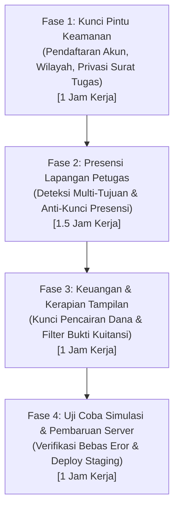

# LAPORAN HASIL EVALUASI MENYELURUH & RENCANA PENYEMPURNAAN SISTEM CATUR
**Aplikasi:** CATUR (*Control Activity and Time Use Record*) — BPS Provinsi Sulawesi Tengah  
**Klasifikasi:** Dokumen Internal Kedinasan — Bahan Evaluasi & Pengambilan Keputusan Pimpinan  
**Tanggal:** 06 November 2026  
**Status:** Evaluasi Selesai (9 Temuan Teridentifikasi & Rencana Solusi Siap Dijalankan)

---

## 1. LATAR BELAKANG & TUJUAN EVALUASI

Aplikasi **CATUR** merupakan instrumen digital utama BPS Provinsi Sulawesi Tengah untuk mencatat, mengendalikan, dan memvalidasi kehadiran pegawai di lapangan secara berbasis lokasi (*GPS tagging*), serta mempermudah pertanggungjawaban pelaporan harian perjalanan dinas.

Seiring dengan baru saja diterapkannya fitur penugasan multi-tujuan (satu surat tugas dapat mencakup beberapa kabupaten/kecamatan) serta pembatasan wilayah akses login akun, tim pengembang dan teknis telah melakukan uji coba simulasi alur kerja secara menyeluruh (*comprehensive end-to-end workflow test*).

Tujuan dari evaluasi ini bukan semata-mata mencari celah teknis, melainkan **memastikan tiga hal utama**:
1. **Kelancaran Petugas di Lapangan:** Tidak ada pegawai yang terhambat atau gagal melakukan presensi swafoto saat berpindah lokasi tugas atau ketika mengalami kendala sinyal/listrik padam di pelosok.
2. **Akuntabilitas Keuangan Negara:** Memastikan proses pencairan anggaran perjalanan dinas mematuhi standar operasional prosedur (SOP) dan aman dari potensi temuan auditor eksternal (BPK) maupun Inspektorat Utama BPS.
3. **Keamanan & Privasi Data:** Memastikan data penugasan, peta wilayah 179 kecamatan se-Sulteng, dan hak akses sistem terlindungi dari manipulasi pihak luar.

Laporan ini disusun dengan bahasa yang lugas, tidak berbelit-belit, dan dilengkapi dengan **gambaran simulasi nyata di lapangan** agar memudahkan Bapak/Ibu Pimpinan dalam memahami kondisi riil sistem dan mengambil keputusan.

---

## 2. RINGKASAN EKSEKUTIF (DASHBOARD KESEHATAN SISTEM)

Dari hasil penelusuran menyeluruh, teridentifikasi **9 temuan** yang dikelompokkan ke dalam 3 pilar operasional utama:

| No | Pilar Operasional | Jumlah Temuan | Tingkat Urgensi | Gambaran Dampak Langsung pada BPS |
| :---: | :--- | :---: | :---: | :--- |
| **1** | **Presensi Lapangan & Kelancaran Petugas** | 2 Temuan | **Sangat Mendesak (Prioritas 1)** | Petugas dinas di lokasi kedua dan seterusnya ditolak absen oleh sistem, atau terkunci total jika sempat terlewat absen 1 hari akibat kendala sinyal/mati lampu. |
| **2** | **Tata Kelola Keuangan & Pertanggungjawaban** | 2 Temuan | **Tinggi (Prioritas 2)** | Anggaran perjalanan dinas secara teknis bisa dicairkan sebelum laporan disetujui/ditandatangani atasan, serta berkas bukti transfer belum dibatasi format resminya. |
| **3** | **Tata Kelola Akun & Keamanan Data BPS** | 5 Temuan | **Tinggi (Prioritas 3)** | Pendaftaran akun publik membiarkan pendaftar memilih menjadi Administrator, data batas wilayah belum dikunci gembok, dan rincian surat tugas bisa diintip pegawai lain. |

---

## 3. PENJELASAN GAMBLANG SETIAP TEMUAN & SIMULASI LAPANGAN

### PILAR 1: KELANCARAN OPERASIONAL PRESENSI PETUGAS DI LAPANGAN

#### Temuan 1.1: Presensi di Lokasi Kedua dan Seterusnya Masih Memeriksa Titik Lokasi Pertama
* **Penjelasan Masalah:**  
  Ketika sebuah Surat Tugas memiliki lebih dari satu lokasi tujuan (contoh: 2 hari di Parigi Moutong, lalu lanjut 3 hari di Poso), sistem pencatatan kehadiran saat ini masih terpaku hanya pada lokasi tujuan pertama. Saat pegawai tiba di lokasi tujuan kedua sesuai jadwal, aplikasi masih mengira pegawai tersebut wajib berada di lokasi pertama.

> [!NOTE] 📌 **GAMBARAN KASUS NYATA DI LAPANGAN**  
> **Skenario:** Pak Budi ditugaskan dinas 5 hari: Hari ke-1 s.d ke-2 di Parigi Moutong, lalu Hari ke-3 s.d ke-5 di Poso.  
> Pada Hari ke-3, Pak Budi tiba di kantor BPS Poso dan membuka aplikasi CATUR untuk melakukan presensi swafoto (*tagging*).  
> **Apa yang Terjadi di HP Pegawai?** Aplikasi menolak presensi Pak Budi dan menampilkan peringatan merah: *"Anda berada di luar wilayah tujuan!"*. Ini terjadi karena aplikasi masih memeriksa koordinat Parigi Moutong, bukan batas koordinat Poso yang menjadi jadwal hari itu.

* **Risiko Bagi BPS:** Pegawai di lapangan frustrasi, presensi dianggap mangkir oleh sistem, dan pengunggahan laporan kegiatan harian terhambat.
* **Solusi Penyempurnaan:** Sistem disempurnakan agar cerdas mencocokkan tanggal hari ini dengan jadwal tujuan yang tertera pada surat tugas. Pada tanggal 1–2 sistem otomatis memvalidasi area Parigi Moutong, dan begitu masuk tanggal 3 sistem otomatis berpindah memvalidasi area Poso tanpa perlu tindakan manual dari admin.

---

#### Temuan 1.2: Petugas Terkunci Total Jika Terlewat 1 Hari Presensi (Misal Sinyal Hilang / Sakit)
* **Penjelasan Masalah:**  
  Aturan sistem saat ini sangat kaku dan mewajibkan urutan hari presensi harus mutlak berturut-turut tanpa boleh ada jeda (Hari 1, Hari 2, Hari 3). Jika ada 1 hari terlewat karena kendala luar (seperti mati lampu di daerah pelosok, *blank spot* sinyal, atau sakit), maka di hari berikutnya sistem menolak absen karena mengharapkan absen hari kemarin diselesaikan terlebih dahulu. Karena tanggal kemarin sudah lewat, pegawai terkunci permanen hingga masa surat tugas habis.

> [!NOTE] 📌 **GAMBARAN KASUS NYATA DI LAPANGAN**  
> **Skenario:** Ibu Siti bertugas survei lapangan ke desa terpencil di Banggai Laut selama 4 hari. Di Hari ke-2, wilayah desa mengalami mati lampu total dan sinyal seluler padam seharian, sehingga Ibu Siti tidak bisa mengunggah presensi.  
> Di Hari ke-3 listrik dan sinyal kembali normal. Saat Ibu Siti membuka CATUR untuk absen Hari ke-3, aplikasi menolak dengan pesan error urutan hari.  
> **Apa yang Terjadi?** Untuk Hari ke-3 dan Hari ke-4, Ibu Siti terkunci total dan tidak bisa lagi melakukan presensi sama sekali di aplikasi.

* **Risiko Bagi BPS:** Rekam jejak kehadiran dinas pegawai menjadi kosong sama sekali untuk sisa hari penugasan, padahal pegawai bersangkutan sebenarnya hadir dan bekerja di lapangan.
* **Solusi Penyempurnaan:** Aturan kunci kaku tersebut dihapus. Petugas diizinkan melakukan presensi pada hari apapun selama tanggal tersebut masih berada dalam rentang surat tugas yang sah. Hari yang terlewat akan otomatis tercatat sebagai *"Tidak Ada Presensi"* secara jujur dan transparan bagi atasan.

---

### PILAR 2: TATA KELOLA KEUANGAN NEGARA & AKUNTABILITAS PERJADIN

#### Temuan 2.1: Dana Perjalanan Dinas Bisa Dicairkan Sebelum Laporan Ditandatangani Atasan
* **Penjelasan Masalah:**  
  Pada modul keuangan, tombol *"Cairkan Dana"* saat ini dapat diklik dan memproses pencairan tanpa memeriksa apakah laporan perjalanan dinas pegawai sudah diverifikasi dan ditandatangani secara digital oleh atasan/pejabat yang berwenang.

> [!NOTE] 📌 **GAMBARAN KASUS NYATA DI LAPANGAN**  
> **Skenario:** Seorang pegawai baru selesai membuat draf laporan kegiatan dinasnya dan belum diperiksa atasan. Staf keuangan secara tidak sengaja mengklik tombol *"Cairkan Dana"* di sistem.  
> **Apa yang Terjadi?** Sistem langsung mencatat dana telah cair dan memproses pengeluaran, padahal atasan belum pernah memeriksa atau menyetujui substansi laporan kegiatan dinas tersebut.

* **Risiko Bagi BPS:** Pencairan anggaran sebelum dokumen pertanggungjawaban disetujui atasan melanggar SOP keuangan negara dan berpotensi menjadi temuan audit kepatuhan oleh BPK atau Inspektorat BPS.
* **Solusi Penyempurnaan:** Memasang penguncian gerbang verifikasi (*workflow gating*). Tombol pencairan hanya akan aktif jika dokumen laporan dinas sudah memiliki status resmi *"Ditandatangani"* oleh atasan langsung / PPK.

---

#### Temuan 2.2: Berkas Bukti Pengeluaran/Kuitansi Belum Memiliki Penyaring Format Resmi
* **Penjelasan Masalah:**  
  Formulir unggah dokumen bukti transfer atau kuitansi di menu keuangan belum membatasi tipe berkas. Semua jenis file dari komputer/HP saat ini dapat terunggah ke server tanpa penyaringan.

> [!NOTE] 📌 **GAMBARAN KASUS NYATA DI LAPANGAN**  
> **Skenario:** Staf atau pegawai salah memilih file di HP (misalnya salah memilih tautan web pintasan, file program, atau file arsip yang rusak). Sistem langsung menerima dan menyimpannya di server tanpa mengecek apakah itu benar-benar foto kuitansi atau dokumen PDF.

* **Risiko Bagi BPS:** Dokumen pertanggungjawaban keuangan menjadi tidak seragam atau rusak saat akan diperiksa pemeriksa, serta membuka celah masuknya berkas asing ke server BPS.
* **Solusi Penyempurnaan:** Mengunci filter berkas hanya untuk format dokumen resmi: Dokumen PDF (`.pdf`) dan Foto Asli (`.jpg`, `.jpeg`, `.png`, `.webp`) dengan batas maksimal 5 MB. Format lain otomatis ditolak sistem.

---

### PILAR 3: TATA KELOLA AKUN, PRIVASI DATA & KEAMANAN SISTEM

#### Temuan 3.1: Halaman Pendaftaran Akun Terbuka Bebas Memilih Peran 'Administrator'
* **Penjelasan Masalah:** Pintu pendaftaran akun baru di aplikasi saat ini membiarkan siapa saja memilih peran akunnya secara bebas tanpa verifikasi internal.

> [!NOTE] 📌 **GAMBARAN KASUS NYATA DI LAPANGAN**  
> **Skenario:** Seseorang dari luar kantor membuka link pendaftaran CATUR. Saat mengisi data, ia sengaja memilih peran *"Admin"* atau *"Keuangan"*.  
> **Apa yang Terjadi?** Akun tersebut langsung aktif dengan kewenangan setara Administrator Provinsi. Akun ini bisa melihat data seluruh pegawai, mengubah peta wilayah, atau mengakses menu anggaran dinas.

* **Risiko Bagi BPS:** Potensi penyalahgunaan wewenang dan pembobolan data internal BPS.
* **Solusi Penyempurnaan:** Pintu pendaftaran umum dikunci permanen: siapapun yang mendaftar secara mandiri otomatis hanya menjadi *"Pegawai Biasa"*. Pengangkatan menjadi Admin, Atasan, atau Tim Keuangan hanya dapat dilakukan secara internal oleh Super Admin melalui menu resmi Pengaturan Akun di dalam kantor.

---

#### Temuan 3.2: Pegawai Berpotensi Melihat Dokumen Surat Tugas Milik Pegawai Lain
* **Penjelasan Masalah:** Sistem belum memeriksa apakah nomor surat tugas yang dibuka di browser benar-benar milik pegawai yang sedang login.

> [!NOTE] 📌 **GAMBARAN KASUS NYATA DI LAPANGAN**  
> **Skenario:** Pegawai A sedang membuka surat tugas miliknya, lalu iseng mengubah nomor angka di tautan peramban (browser). Aplikasi langsung menampilkan surat tugas milik Pegawai B lengkap dengan tujuan perjalanan dan rincian anggarannya.

* **Risiko Bagi BPS:** Pelanggaran privasi dan kerahasiaan penugasan dinas antar-pegawai.
* **Solusi Penyempurnaan:** Memberi gembok kepemilikan. Pegawai biasa hanya bisa membaca surat tugas miliknya sendiri. Jika mencoba membuka milik orang lain, sistem langsung menampilkan peringatan *"Akses Ditolak"*.

---

#### Temuan 3.3: Data Wilayah & Batas Peta Belum Dilindungi Gembok Administrator
* **Penjelasan Masalah:** Jalur pembaruan dan sinkronisasi data wilayah (179 kecamatan dan 13 kabupaten/kota) saat ini belum dilengkapi verifikasi login administrator.

> [!NOTE] 📌 **GAMBARAN KASUS NYATA DI LAPANGAN**  
> **Skenario:** Perintah sinkronisasi atau penghapusan data wilayah dapat terpicu tanpa perlu login admin, yang dapat mengakibatkan koordinat batas wilayah dan poligon kecamatan yang sudah diatur menjadi hilang atau rusak.

* **Risiko Bagi BPS:** Jika koordinat batas wilayah suatu kecamatan terhapus, seluruh petugas BPS di kecamatan tersebut akan gagal absen karena batas wilayahnya hilang dari peta.
* **Solusi Penyempurnaan:** Seluruh akses penambahan wilayah, pengubahan batas koordinat, dan sinkronisasi peta dipasangi kunci otorisasi khusus Administrator BPS.

---

#### Temuan 3.4 & 3.5: Kerapian Tampilan Halaman Admin & Privasi Notifikasi
* **Temuan 3.4 (Tirai Layar Admin):** Formulir menu admin di browser belum diberi tirai pelindung otomatis. Pegawai biasa yang mengetikkan alamat URL admin sempat melihat form kosong sekejap sebelum sistem menolak. *Solusi:* Layar langsung dialihkan kembali ke Dashboard Pegawai secara mulus.
* **Temuan 3.5 (Privasi Notifikasi):** Tindakan membaca notifikasi dikunci khusus ke ID pegawai yang bersangkutan agar tidak saling mempengaruhi antrean pemberitahuan dinas milik rekan lain.

---

## 4. TABEL PERBANDINGAN: KONDISI SEBELUM VS SESUDAH

| No | Komponen Sistem | Kondisi Saat Ini (Sebelum Dibenahi) | Kondisi Baru (Setelah Dibenahi) | Manfaat Nyata Bagi BPS |
| :---: | :--- | :--- | :--- | :--- |
| **1** | **Presensi Multi-Tujuan** | Hanya lokasi pertama yang dikenali. Pindah ke kabupaten kedua ditolak absen. | Sistem otomatis mengikuti jadwal tanggal hari ini. | Pegawai bisa absen lancar di seluruh kabupaten/kecamatan tujuan. |
| **2** | **Presensi Terlewat** | Terkunci permanen jika terlewat 1 hari (karena listrik/sinyal mati). | Tetap bisa absen di hari berikutnya. Hari terlewat tercatat transparan. | Menghindari data kosong untuk sisa hari dinas pegawai. |
| **3** | **Pencairan Anggaran** | Tombol cair bisa ditekan sebelum laporan dinas disetujui atasan. | Terkunci otomatis. Baru bisa cair setelah atasan resmi tanda tangan. | Memenuhi SOP keuangan negara dan aman dari temuan BPK/Itwil. |
| **4** | **Pendaftaran Akun** | Pendaftar bebas memilih menjadi Admin atau Bagian Keuangan. | Terkunci permanen sebagai Pegawai. Hak khusus diatur manual dari kantor. | Mencegah orang luar menyusup menjadi administrator sistem. |
| **5** | **Privasi Surat Tugas** | Pegawai bisa mengintip surat tugas pegawai lain lewat tautan peramban. | Terkunci privat. Pegawai hanya bisa melihat surat tugas miliknya sendiri. | Menjamin kerahasiaan penugasan dan rincian dinas pegawai. |
| **6** | **Bukti Kuitansi** | Semua format file bisa masuk ke server tanpa saringan resmi. | Dibatasi ketat hanya Dokumen PDF dan Foto Asli (JPG/PNG). | Arsip pertanggungjawaban rapi, seragam, dan server aman. |

---

## 5. TAHAPAN PELAKSANAAN & JAMINAN KELANCARAN OPERASIONAL

Pelaksanaan perbaikan direncanakan dalam **4 tahapan kerja terukur** dengan total estimasi pengerjaan **4 hingga 5 jam kerja**:

> [!IMPORTANT] **JAMINAN KEAMANAN DATA (ZERO DATA LOSS):**  
> Seluruh perbaikan ini dilakukan pada tingkat logika sistem dan validasi alur kerja, **tanpa mengubah atau menghapus data perjalanan dinas yang sudah tersimpan di database saat ini**. Pencadangan data (*backup*) akan dilakukan terlebih dahulu sebelum sistem diperbarui ke server resmi.

---

## 6. REKOMENDASI KEPUTUSAN UNTUK PIMPINAN

Berdasarkan hasil evaluasi menyeluruh di atas, tim pengembang dan teknis merekomendasikan kepada **Pimpinan BPS Provinsi Sulawesi Tengah** untuk memberikan persetujuan pelaksanaan rencana penyempurnaan sistem CATUR (**TASK-046**).

### Poin-Poin Tindakan yang Dimohonkan Persetujuan:
1. **Menyetujui** penerapan otomatisasi deteksi lokasi multi-tujuan hari berjalan dan penghapusan kunci kaku presensi harian agar petugas di lapangan tidak terhambat.
2. **Menyetujui** penguncian syarat tanda tangan atasan sebelum dana perjalanan dinas dapat dicairkan oleh bagian keuangan demi kepatuhan SOP keuangan.
3. **Menyetujui** pengetatan hak akses pendaftaran akun, proteksi privasi dokumen surat tugas, dan penguncian data batas wilayah.

---

*Laporan ini disiapkan sebagai bahan pertimbangan resmi pimpinan BPS Provinsi Sulawesi Tengah.*
