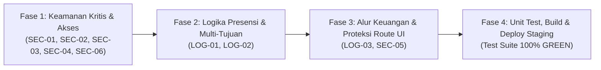

# Implementation Plan: Perbaikan Menyeluruh Hasil Audit Keamanan, Logika Bisnis, & Test Suite (`TASK-046`)

Dokumen ini menjabarkan rencana eksekusi teknis yang terstruktur untuk menutup seluruh **9 temuan kerentanan & bug logika bisnis** yang ditemukan pada audit sistem CATUR, sekaligus menyempurnakan rangkaian unit test backend agar lulus 100% tanpa ketergantungan koneksi database lokal.

---

## 1. Peta Eksekusi Perbaikan (4 Fase Terstruktur)



---

## 2. Rincian Perubahan per Fase

### Fase 1 — Penutupan Celah Keamanan & Kontrol Akses Backend (`SEC-01`, `SEC-02`, `SEC-03`, `SEC-04`, `SEC-06`)

| Kode | File yang Diubah | Detail Perbaikan Teknis |
| :---: | :--- | :--- |
| **SEC-01** | [`backend/src/controllers/auth.controller.js`](file:///c:/Users/Lyvn/Laravel/CATUR/backend/src/controllers/auth.controller.js)<br>[`backend/src/services/auth.service.js`](file:///c:/Users/Lyvn/Laravel/CATUR/backend/src/services/auth.service.js) | **Cegah Privilege Escalation pada Registrasi Publik:** Mengabaikan input `role` dari body pada endpoint publik `POST /api/auth/register` dan memaksa nilai `role: 'pegawai'`. Pembuatan akun `admin`, `atasan`, dan `keuangan` hanya dapat dilakukan melalui endpoint Admin (`POST /api/user` dengan middleware `auth` + `isAdmin`). |
| **SEC-02** | [`backend/src/routes/daerah.route.js`](file:///c:/Users/Lyvn/Laravel/CATUR/backend/src/routes/daerah.route.js) | **Proteksi Endpoint Manajemen Wilayah:** Memasang middleware `authMiddleware` dan `adminMiddleware` pada route mutasi data wilayah (`POST /`, `PUT /:id`, `DELETE /:id`, dan `POST /sync-geojson`), serta `authMiddleware` pada endpoint baca (`GET /`, `GET /count`, `GET /:id`). |
| **SEC-03** | [`backend/src/controllers/suratTugas.controller.js`](file:///c:/Users/Lyvn/Laravel/CATUR/backend/src/controllers/suratTugas.controller.js) | **Tutup Celah IDOR pada Detail Surat Tugas (`getById`):** Menambahkan validasi kepemilikan pada `GET /api/surat-tugas/:id`: jika `req.user.role === 'pegawai'` dan `Number(data.user_id) !== Number(req.user.id)`, kembalikan `HTTP 403 Forbidden`. |
| **SEC-04** | [`backend/src/routes/keuangan.routes.js`](file:///c:/Users/Lyvn/Laravel/CATUR/backend/src/routes/keuangan.routes.js) | **Validasi Ketat File Upload Bukti Transfer:** Mengganti `fileFilter` yang sebelumnya bebas (`cb(null, true)`) menjadi validasi ketat MIME type (`image/jpeg`, `image/jpg`, `image/png`, `image/webp`, `application/pdf`) dan ekstensi file (`.jpg`, `.jpeg`, `.png`, `.webp`, `.pdf`) untuk mencegah Stored XSS / arbitrary file upload. |
| **SEC-06** | [`backend/src/controllers/notifikasi.controller.js`](file:///c:/Users/Lyvn/Laravel/CATUR/backend/src/controllers/notifikasi.controller.js) | **Tutup Celah IDOR pada Notifikasi (`markAsRead`):** Menambahkan filter kepemilikan `where: { id: req.params.id, user_id: req.user.id }` saat menandai notifikasi telah dibaca. |

---

### Fase 2 — Perbaikan Logika Inti Presensi Lapangan & Multi-Tujuan (`LOG-01`, `LOG-02`)

1. **`LOG-01` — Validasi Geofencing Mengikuti Tujuan Aktif Hari Ini ([`backend/src/controllers/presensi.controller.js`](file:///c:/Users/Lyvn/Laravel/CATUR/backend/src/controllers/presensi.controller.js)):**
   - **Masalah Saat Ini:** Fungsi [`presensiDinas`](file:///c:/Users/Lyvn/Laravel/CATUR/backend/src/controllers/presensi.controller.js#L215-L436) dan [`cekPresensiHariIni`](file:///c:/Users/Lyvn/Laravel/CATUR/backend/src/controllers/presensi.controller.js#L512-L660) masih mencari surat dengan query manual dan mengecek `Daerah.findByPk(surat.daerah_id)` (yang selalu menunjuk ke tujuan pertama).
   - **Solusi Perbaikan:**
     - Menggunakan [`resolveActiveAssignment(userId, today)`](file:///c:/Users/Lyvn/Laravel/CATUR/backend/src/services/activeAssignment.service.js#L41-L89) untuk mendapatkan pasangan `{ surat, tujuanAktif }` yang sesuai dengan jadwal tanggal hari ini (`today`).
     - Mengambil `targetDaerahId = tujuanAktif?.daerah_id || surat.daerah_id` dan `targetDaerah = tujuanAktif?.daerah || await Daerah.findByPk(targetDaerahId)`.
     - Mengevaluasi `evaluateTaggingZone(latNum, lonNum, tujuanAktif || surat, targetDaerah)` serta menyimpan `surat_tugas_tujuan_id: tujuanAktif?.id || null` pada record `Presensi` yang dibuat.

2. **`LOG-02` — Hapus Penguncian Permanen (*Permanent Lockout*) Saat Ada Hari yang Terlewat ([`backend/src/controllers/presensi.controller.js`](file:///c:/Users/Lyvn/Laravel/CATUR/backend/src/controllers/presensi.controller.js#L348-L356)):**
   - **Masalah Saat Ini:** Pengecekan `if (hariKe !== expectedHariKe)` menolak pegawai untuk absen di Hari ke-3 jika Hari ke-2 terlewat (sakit/blank spot sinyal), sedangkan pegawai tidak bisa absen mundur untuk hari kemarin.
   - **Solusi Perbaikan:**
     - Menghapus blokir keras `hariKe !== expectedHariKe` yang mengunci hari-hari berikutnya.
     - Memastikan pegawai hanya divalidasi bahwa:
       1. Tanggal hari ini (`today`) berada dalam rentang masa berlaku surat tugas (`hariKe >= 1 && hariKe <= durasiHari`).
       2. Pegawai belum melebihi batas presensi pada tanggal hari ini (`today`).
       3. Jika ada presensi sebelumnya yang baru memiliki 1 foto, hanya mewajibkan kelengkapan foto jika presensi tersebut berada di hari yang sama, tanpa memblokir hari kalender baru.

---

### Fase 3 — Pengamanan Alur Pencairan Dana & Proteksi Route Frontend (`LOG-03`, `SEC-05`)

1. **`LOG-03` — Validasi Status Persetujuan Atasan Sebelum Pencairan Dana ([`backend/src/controllers/keuangan.controller.js`](file:///c:/Users/Lyvn/Laravel/CATUR/backend/src/controllers/keuangan.controller.js#L355-L394)):**
   - Pada fungsi [`cairkanDana`](file:///c:/Users/Lyvn/Laravel/CATUR/backend/src/controllers/keuangan.controller.js#L355), menambahkan pengecekan status laporan:
     ```javascript
     if (!['ditandatangani', 'pencairan_dana'].includes(laporan.status)) {
       return res.status(400).json({
         success: false,
         message: 'Dana hanya dapat dicairkan setelah laporan ditandatangani oleh pimpinan.',
       });
     }
     ```

2. **`SEC-05` — Proteksi Seluruh Route Halaman di React Router ([`frontend/src/App.jsx`](file:///c:/Users/Lyvn/Laravel/CATUR/frontend/src/App.jsx#L51-L72)):**
   - Membungkus seluruh route yang belum terproteksi menggunakan [`ProtectedRoute`](file:///c:/Users/Lyvn/Laravel/CATUR/frontend/src/routes/ProtectedRoute.jsx):
     - Route Admin (`allowedRoles={["admin"]}`): `/admin-daerah`, `/pengaturan-akun`, `/admin/peta-sulteng`, `/admin/surat-tugas/create`, `/informasi-catur`.
     - Route Pegawai (`allowedRoles={["pegawai"]}`): `/dashboard`, `/surat-tugas`, `/presensi`, `/informasi-aplikasi`.
     - Route Atasan (`allowedRoles={["atasan"]}`): `/informasi-atasan`.
     - Route Keuangan (`allowedRoles={["keuangan"]}`): `/informasi-keuangan`.
     - Route Profil Umum (`allowedRoles={["admin", "pegawai", "atasan", "keuangan"]}`): `/profil`.

---

### Fase 4 — Perbaikan Unit Test Backend, Pengujian Regresi, Build & Deploy

1. **Perbaikan Unit Test [`backend/tests/unit/presensi.list.test.js`](file:///c:/Users/Lyvn/Laravel/CATUR/backend/tests/unit/presensi.list.test.js):**
   - Mengubah pengujian di `presensi.list.test.js` agar tidak gagal ketika PostgreSQL lokal (`127.0.0.1:5432`) sedang tidak aktif:
     - Test pertama (`daftar presensi hanya mengambil data milik user login`) adalah *pure unit test* yang sudah melakukan mock pada `Presensi.findAll`, sehingga tidak memerlukan `sequelize.authenticate()`.
     - Test kedua (integrasi HTTP `/api/presensi`) akan otomatis dijalankan jika database tersedia atau melakukan mock/skip secara bersih jika `CATUR_TEST_DATABASE_URL` tidak dikonfigurasi (konsisten dengan file test integrasi lainnya).
2. **Penambahan Unit Test Baru untuk Hasil Audit:**
   - Menambahkan unit test backend `backend/tests/unit/audit.security-logic.test.js` yang memverifikasi:
     - `SEC-01`: Registrasi publik selalu mengunci `role: 'pegawai'` meskipun diberi `role: 'admin'`.
     - `SEC-03`: `getById` surat tugas menolak akses `pegawai` ke surat tugas milik pegawai lain (`HTTP 403`).
     - `SEC-06`: `markAsRead` notifikasi selalu memfilter `user_id: req.user.id`.
     - `LOG-03`: `cairkanDana` menolak laporan yang belum berstatus `ditandatangani` (`HTTP 400`).
3. **Verifikasi Menyeluruh & Deployment ke Staging (`https://caturv2.gimmhost.my.id/`):**
   - Menjalankan seluruh unit test Backend dan Frontend (Vitest) hingga **100% PASS (0 Failed)**.
   - Melakukan build production frontend, mencatat pada `CHANGELOG.md`, commit & push ke GitHub, serta men-deploy perubahan backend & frontend ke server staging.
