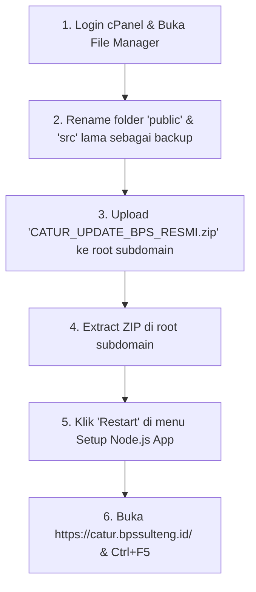

# PANDUAN RESMI UPDATE APLIKASI CATUR DI SERVER BPS SULTENG
**Domain Resmi:** `https://catur.bpssulteng.id/`  
**Paket File:** `CATUR_UPDATE_BPS_RESMI.zip` (1.48 MB)  
**Tanggal Rilis Update:** 06 November 2026  
**Metode:** Upload & Extract via cPanel File Manager (Subdomain Root)

---

## 1. RINGKASAN PEMBARUAN YANG DIBAWA PAKET INI

Paket update ini membawa seluruh perbaikan dan fitur baru dari sesi pengembangan terakhir tanpa mengubah skema tabel database produksi:
* **Fitur Dropdown Interaktif & Pencarian:** Dropdown combobox `SearchableSelect` dengan layout Daftar Isi (*dotted leader*).
* **Fitur Pembatasan Akses Satker Kab/Kota:** Akun BPS daerah otomatis terkunci ke kabupatennya, BPS Provinsi akses seluruh wilayah.
* **Fitur Dropdown Berjenjang (Cascading):** Memilih Kabupaten/Kota langsung menyaring hanya Kecamatan ber-poligon (13 Kab/Kota & 179 Kecamatan se-Sulteng).
* **Perbaikan Tata Letak Responsif:** Sidebar HP & Tablet tidak lagi menabrak konten (laci *off-canvas*).
* **Perbaikan Bug Laporan Harian Terbaca Kosong:** Presensi Step 2 simpan laporan harian kini tersimpan utuh dan langsung ke Step 3.
* **Perbaikan Bug Opsi Dropdown Wilayah Kosong:** Filter wilayah saat dinonaktifkan/direset otomatis memunculkan seluruh wilayah default.

---

## 2. FILE SERVER YANG WAJIB DIPERTAHANKAN (JANGAN DIHAPUS / JANGAN DITIMPA)

Paket ZIP ini **hanya** berisi folder `public/` (frontend build) dan folder `src/` (backend logic). File-file berikut di server produksi **TIDAK BOLEH DIHAPUS**:
* `.env` *(Koneksi PostgreSQL produksi, JWT Secret, Drive)*
* `uploads/` *(Seluruh file foto presensi dan surat tugas pegawai yang sudah ada)*
* `node_modules/` *(Seluruh library server — tidak ada library baru yang ditambah)*
* `credential.json` / `token.json` *(Kredensial OAuth Google Drive BPS jika ada)*
* `index.js` / `server.js` *(File startup Node.js Passenger)*
* `tmp/` *(Folder trigger restart aplikasi)*

---

## 3. LANGKAH-LANGKAH UPDATE STEP-BY-STEP DI CPANEL

### Langkah 1: Siapkan File Update
Pastikan Anda sudah memiliki file:
📁 **`CATUR_UPDATE_BPS_RESMI.zip`** *(Lokasi: Root folder proyek lokal Anda / [CATUR_UPDATE_BPS_RESMI.zip](file:///c:/Users/Lyvn/Laravel/CATUR/CATUR_UPDATE_BPS_RESMI.zip))*.

### Langkah 2: Masuk ke cPanel & Buka File Manager
1. Buka browser dan login ke cPanel server BPS Sulteng.
2. Klik ikon menu **File Manager**.
3. Di panel sebelah kiri, cari dan buka folder root subdomain CATUR:  
   *(Biasanya bernama `/catur.bpssulteng.id` atau `/public_html/catur`)*.

### Langkah 3: Backup Folder Lama di Server (Safety First)
1. Di dalam folder root subdomain tersebut, cari folder **`public`** dan **`src`**.
2. Klik kanan folder **`public`** $\rightarrow$ pilih **Rename** $\rightarrow$ ubah namanya menjadi:  
   `public_backup_20261106`
3. Klik kanan folder **`src`** $\rightarrow$ pilih **Rename** $\rightarrow$ ubah namanya menjadi:  
   `src_backup_20261106`

> [!NOTE] **Kenapa perlu di-rename?**  
> Dengan mengubah nama folder lama, seluruh file lama tetap aman tersimpan di server. Jika sewaktu-waktu ingin kembali (*rollback*), Anda tinggal mengubah namanya kembali dalam 5 detik.

### Langkah 4: Upload & Extract Paket Update
1. Masih di halaman File Manager folder subdomain CATUR, klik tombol **Upload** di bilah menu bagian atas.
2. Klik **Select File** dan pilih file **`CATUR_UPDATE_BPS_RESMI.zip`** dari komputer Anda.
3. Tunggu hingga bar pengunggahan mencapai **100% dan berwarna hijau**.
4. Tutup tab upload, lalu klik tombol **Reload** di File Manager.
5. Klik kanan pada file **`CATUR_UPDATE_BPS_RESMI.zip`** $\rightarrow$ pilih **Extract** $\rightarrow$ klik **Extract File(s)**.
6. Periksa isi direktori: sekarang sudah ada folder **`public`** baru dan folder **`src`** baru yang sejajar dengan `.env`.
7. Anda boleh menghapus file `CATUR_UPDATE_BPS_RESMI.zip` dari server setelah ekstraksi selesai agar menghemat ruang penyimpanan.

### Langkah 5: Restart Node.js Application di cPanel
1. Kembali ke tab dashboard utama cPanel.
2. Cari dan klik menu **Setup Node.js App** (di bagian *Software*).
3. Pada tabel daftar aplikasi, cari baris aplikasi `catur.bpssulteng.id`.
4. Klik tombol **Restart** (ikon panah melingkar / tombol warna oranye/biru).
5. *(Alternatif manual jika tidak ada menu Node.js App)*: Di File Manager, masuk ke folder `tmp`, lalu buat file kosong baru dengan nama `restart.txt`.

### Langkah 6: Uji Coba & Verifikasi di Browser
1. Buka tab baru di browser Anda dan akses:  
   👉 **`https://catur.bpssulteng.id/`**
2. Tekan kombinasi tombol **`Ctrl + F5`** (Hard Refresh) untuk membersihkan cache skrip lama browser.
3. Login ke dalam sistem dan lakukan pengetesan cepat:
   * **Menu Surat Tugas:** Coba pilih Kabupaten/Kota $\rightarrow$ verifikasi hanya Kecamatan ber-poligon di kabupaten tersebut yang muncul.
   * **Menu Presensi:** Coba simpan Laporan Harian $\rightarrow$ verifikasi tombol simpan laporan sukses tersimpan tanpa error *"Laporan tidak boleh kosong"*.
   * **Tampilan Mobile:** Cek via browser HP $\rightarrow$ sidebar rapi menggunakan sistem laci geser (*off-canvas*).

---

## 4. PROSEDUR ROLLBACK (JIKA DIBUTUHKAN)

Jika terjadi kendala mendadak pada saat pengujian pasca-update:
1. Di cPanel File Manager, hapus folder `public` dan folder `src` yang baru.
2. Rename kembali `public_backup_20261106` menjadi `public`.
3. Rename kembali `src_backup_20261106` menjadi `src`.
4. Klik **Restart** di menu *Setup Node.js App*.
Sistem akan kembali persis ke kondisi sebelum update dalam waktu kurang dari 1 menit.
